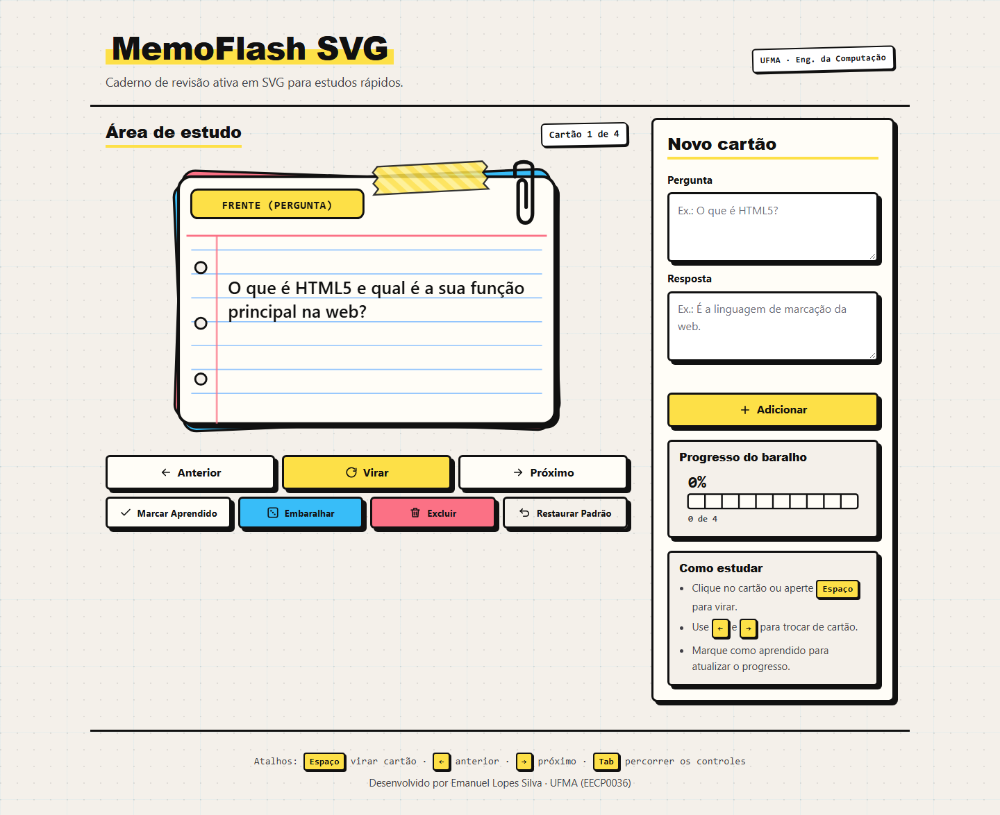
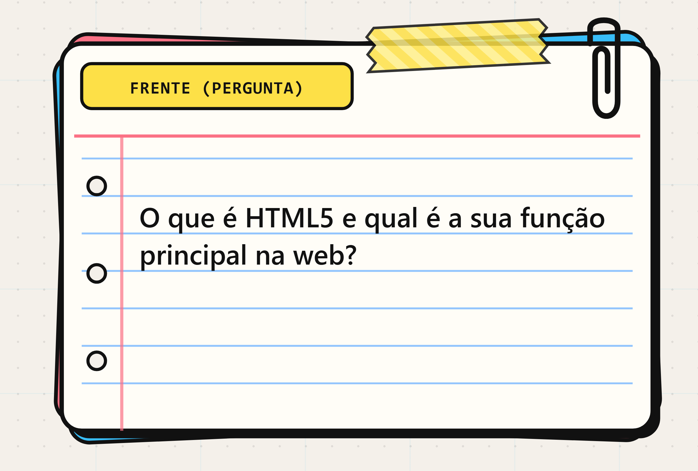
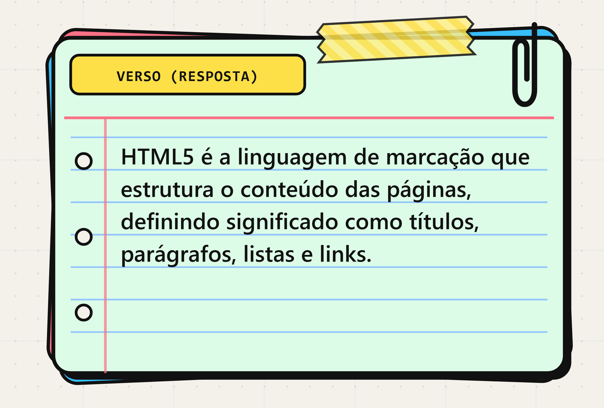
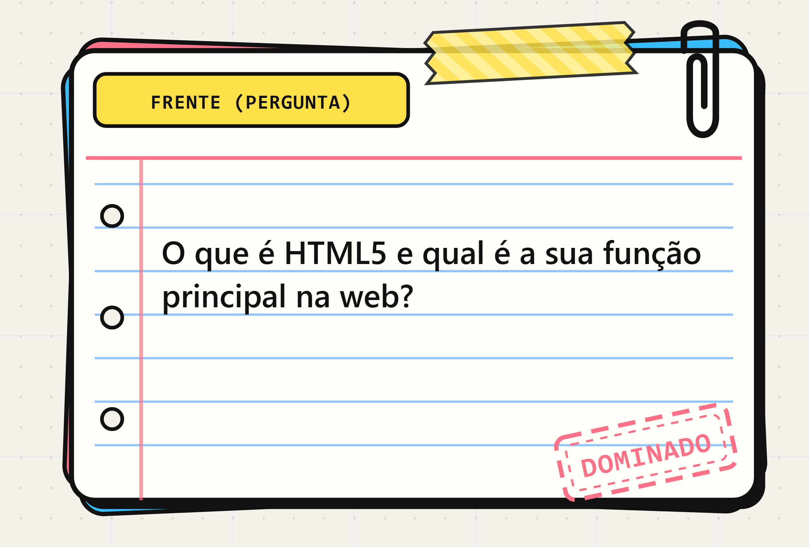
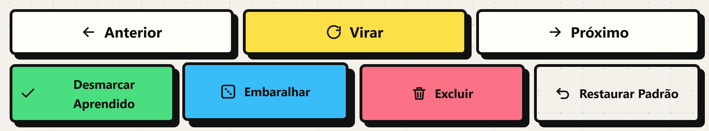
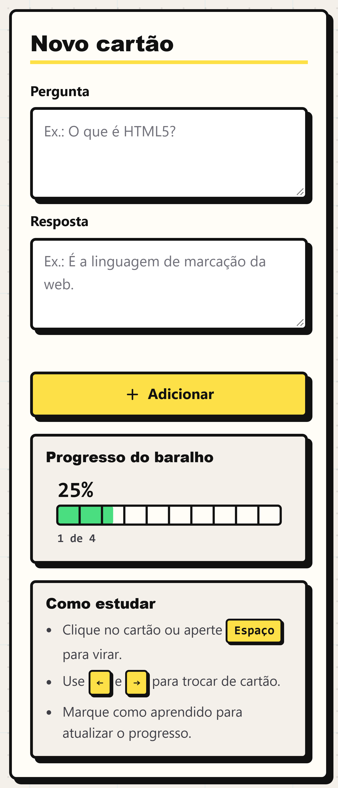
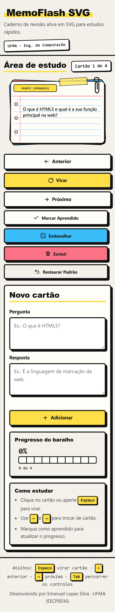
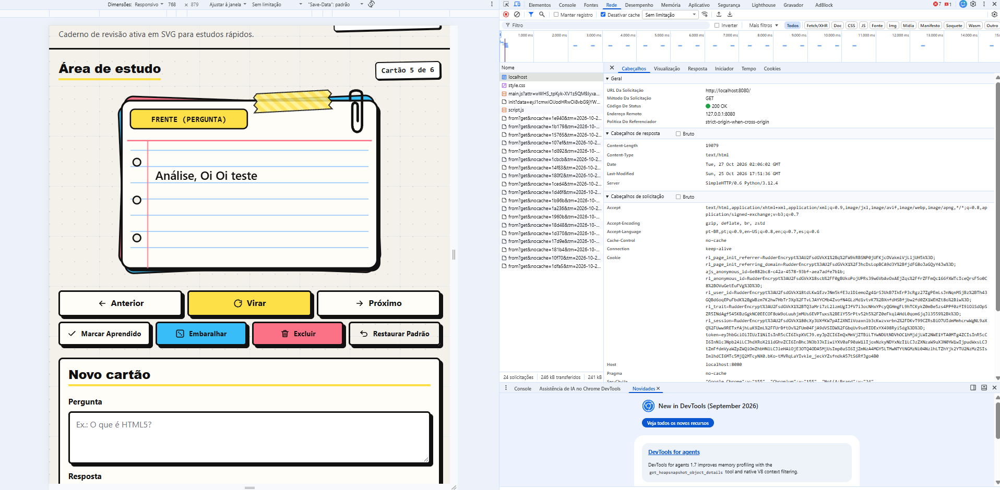

# MemoFlash SVG

Caderno de revisão ativa em SVG para estudos rápidos. Flashcards desenhados em
SVG puro dentro de uma interface neo-brutalista de papel e tinta: molduras pretas
de 3px, sombras duras sem blur, fita washi, clipe de papel e carimbo.



**Stack:** HTML5 semântico · CSS3 · JavaScript puro (ES6+) · zero frameworks · roda direto do `file://`


## O cartão



Cada face é um único `<svg viewBox="0 0 540 360">` montado por camadas:

| camada | detalhe |
| --- | --- |
| pilha | 2 fichas de fundo tortas — ciano `#38bdf8` a −2.5°, coral `#fb7185` a +2° |
| sombra | retângulo preto deslocado +6/+6, sem blur |
| papel | creme `#fffdf7` na frente, menta `#dcfce7` no verso, borda 3.5px |
| pautas | linhas azuis a cada 30px, de y=118 a y=298 |
| margens | vermelha no topo (y=100) e coral suave vertical em x=82 |
| furos | 3 furos de fichário em `cx=62` (cy 140/210/280, r=7) |
| fita washi | listrada, pontas em zigue-zague, opacidade 0.85, inclinação −3° |
| clipe | curva de papel no canto superior direito |
| badge | `FRENTE (PERGUNTA)` / `VERSO (RESPOSTA)` em amarelo marca-texto |
| texto | coluna em x=96, largura máxima 388px, fonte que reduz de 22px até 14px para caber |



Quando o cartão é marcado como aprendido aparece o carimbo `DOMINADO`, com duas
bordas tracejadas e rotação de −12°:



## Microinterações

Botões levantam no hover (`translate(-2px, -2px)` + sombra 7px) e afundam na
própria sombra ao serem pressionados (`translate(3px, 3px)` + sombra 2px):



Os campos de pergunta e resposta ficam com papel amarelo `#fefce8` e a sombra
desloca de 5px para 6px enquanto você escreve:



O anel de foco (3px com offset de 4px) continua visível para quem navega por
teclado.

## Responsivo

A grade colapsa para uma coluna abaixo de 960px e os controles viram botões de
largura cheia abaixo de 430px, sem rolagem horizontal a partir de 360px:



## Design system

| token | hex | onde aparece |
| --- | --- | --- |
| `--paper` | `#f4f0ea` | fundo da página, furos do cartão |
| `--ink` | `#111111` | texto, bordas e sombras |
| `--card` | `#fffdf7` | papel da ficha, painéis |
| `--yellow` | `#fde047` | marca-texto, botão Virar, badges |
| `--mint` | `#4ade80` | progresso, botão Marcar Aprendido |
| `--coral` | `#fb7185` | margens, carimbo, botão Excluir |
| `--cyan` | `#38bdf8` | botão Embaralhar, ficha da pilha |

Sem roxo e sem índigo em lugar nenhum: a paleta antiga foi removida por
completo.

**Tipografia:** sans pesada de sistema (Arial Black / Segoe UI Black) nos
títulos e monoespaçada (Consolas / Cascadia Mono / Courier New) no contador,
nos badges, nos atalhos e nas leituras de progresso. Nenhuma fonte é baixada em
tempo de execução.

## Funcionalidades

- baralho persistido em `localStorage` (`memoflash-v1`) com restauração do padrão
- virar o cartão pelo clique ou por `Espaço`, navegar com `←`/`→` e `Tab`
- adicionar cartões com validação e aviso em região viva
- embaralhar, excluir o cartão atual e restaurar o baralho original
- marcar/desmarcar aprendido com rajada de 14 partículas tiradas da paleta
- medidor segmentado de progresso em SVG (10 células) com `0% … 100%`
- estado vazio explícito no SVG quando não há cartão
- atalhos de teclado no rodapé e limite de 600 caracteres por texto, 200 cartões
  e 256KB de payload gravado

## Segurança

- CSP no `<meta>`: `default-src 'self'`, `connect-src 'none'`, `object-src 'none'`,
  `form-action 'none'`, mais `require-trusted-types-for 'script'`
- todo texto dinâmico entra no DOM por `.textContent` — **0 ocorrências** de
  `innerHTML`, `outerHTML`, `insertAdjacentHTML`, `document.write`, `eval` e
  `new Function` nos três arquivos
- elementos SVG só são criados por uma allowlist (`svgEl` recusa `script`,
  `foreignObject`, handlers, `href` e `style`)
- `sanitizeText`/`sanitizeStored` removem caracteres de controle e títulos de
  override antes de qualquer renderização ou gravação
- nenhuma requisição de rede, nenhuma fonte externa, nenhum framework

## Acessibilidade

- landmarks `header`/`main`/`section`/`aside`/`footer`, labels ligados aos
  campos e `aria-live` no contador e no aviso do formulário
- o cartão é `role="button"` com `tabindex` e ativação pelo teclado
- foco sempre visível; botão de aprendido com `aria-pressed`; ícones com `aria-hidden`
- `prefers-reduced-motion` desliga as animações
- sem JavaScript o documento continua legível (fichas, badge, medidor e textos
  estáticos já estão no HTML)

## Como rodar

```bash
git clone https://github.com/EmanuelSilva69/p1-web.git
cd p1-web
start index.html
```

Não há build, dependências nem instalação. Se preferir servidor local:

```bash
python -m http.server 8080
```

## Rede

Lembrando que usei a Trilha C:
A imagem da aba Rede (Network) do navegador demonstra a requisição HTTP GET realizada ao servidor local (http://localhost:8000/), que retornou o código de status 200 OK com sucesso. Como a aplicação opera na Trilha C, todo o conteúdo estático (index.html, style.css e script.js) é executado diretamente no navegador do usuário, com persistência de dados gerenciada localmente via localStorage.


## Estrutura

```
p1-web/
├── index.html    markup semântico + SVG estático das duas faces
├── style.css     tokens, superfície de papel, molduras e microanimações
├── script.js     estado único + render explícito, sem framework
├── docs/         capturas usadas neste README
└── openspec/     specs e tasks das mudanças (workflow OpenSpec)
```

## Autoria

Desenvolvido por Emanuel Lopes Silva · UFMA (EECP0036)
